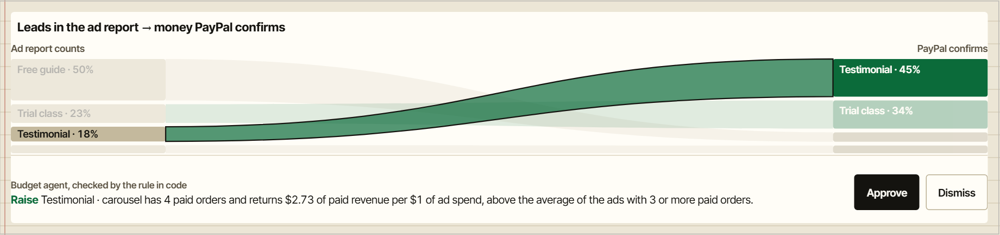
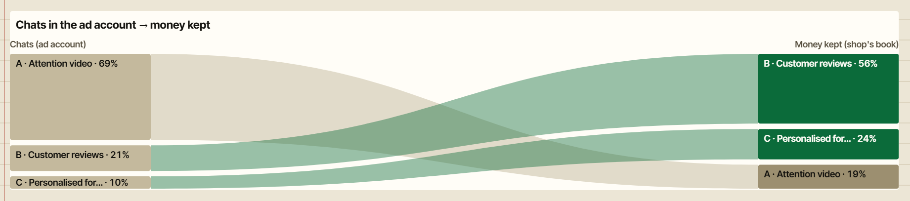
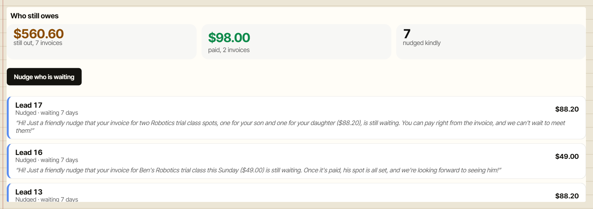
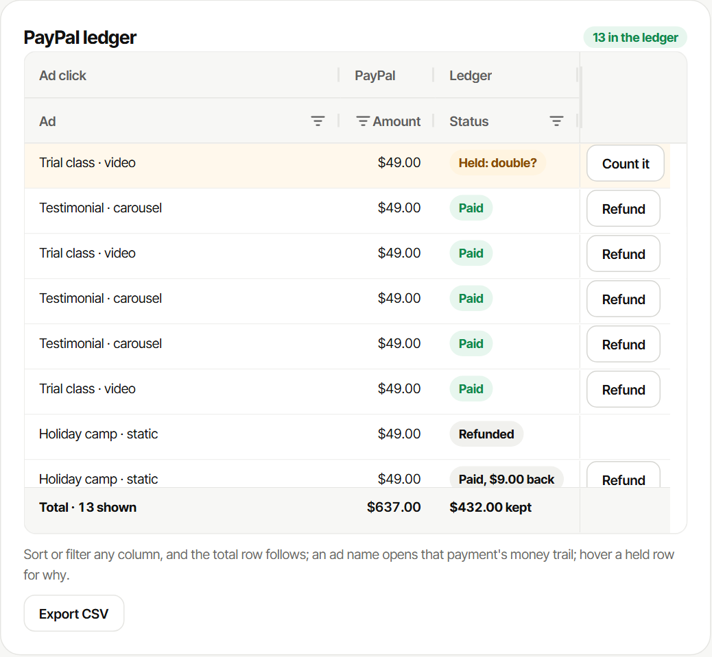

# AG Studio in Paid Signal: how it is built

Open it: [paid-signal.thelongmarketing.workers.dev/studio](https://paid-signal.thelongmarketing.workers.dev/studio) (no login; this link opens the report straight away and only reads). Code: `web/src/`.

The report answers one question for a small shop: what each ad *claims* (leads, chats) against what PayPal *confirms*
(paid orders, money kept after refunds). Studio's agents work in it, and they act on PayPal, not only read.

## What it looks like

A click on the testimonial ad's band filters the page and shows the budget agent's checked verdict, to approve or dismiss:

The same widget on the real gift shop's October book: 69% of the chats, 19% of the money kept.

Who still owes, with the Nudge button that sends PayPal reminders through the chase agent:

And on the dashboard, the PayPal ledger as an AG Grid table, with column groups, a total row that follows the filters,
CSV export and an action on each row:

## What the agents write, and what stops them

The agents in Studio and the app do not only read: they write to PayPal. Code sets the limits, not the prompt.

| Agent | Writes | Limit in code |
|---|---|---|
| Revenue agent (Studio tool "draft invoices") | PayPal invoice drafts through the Agent Toolkit | price and recipient set in code inside the call; a draft waits for a person; the send agent sends it only after approval |
| Nudge agent (Studio) and the Nudge button | PayPal invoice reminders through the chase agent | the owner's click or request; unpaid invoices only, at most three per run |
| Budget agent (Studio) | a budget recommendation, then the owner's decision | the evidence gate checks every number and capture id against the ledger; no move on fewer than 3 paid orders; a decision is recorded, no live Meta budget changes |
| Refund agent (app) | a PayPal refund | only the flagged second capture, its full amount, once per approval |
| Commission agent (app) | a PayPal Payouts payment to the ad's creator | recipient fixed in code; $5 per PayPal-confirmed paid order not refunded, disputed, held or already paid |

## Data

`studio.js`, `buildData`: five tables, built from numbers the server already settled (Studio only groups and sums).

| Table | Rows | From |
|---|---|---|
| Ads | one per ad | the ad export joined to PayPal captures (`/api/reconcile`) |
| PayPal captures | one per payment | the ledger, attributed by the click id in each order's `custom_id` |
| Invoices sent | one per PayPal invoice | the invoices the agents drafted and a person approved |
| Real shop: ad groups | 3 | a real gift shop's October (`public/data/merchant-case.json`) |
| Real shop: payments | 735 | the shop's published payment book (`public/data/shop/payments-2026-10.csv`) |

Relations join captures to ads and shop payments to shop groups; named measures (cost per paid order, paid revenue per
$1 of ads, money kept per 1 spent) carry their own formats (USD, VND). `test/studio-totals.test.js` checks that Studio's
totals equal the ledger's and the shop book's (705 kept orders, 1,317M VND, 12,100 chats).

## Report

Six pages: Ads vs PayPal, PayPal captures, Ad → PayPal → Meta, Who still owes, Real shop: October, and a blank Your page.
A phone layout re-flows every page. **Save layout** keeps the owner's version in the browser; **Reset** restores it.

## Theme

A "ledger" look drawn first on a Claude Design canvas, then set through Studio's theme parameters (`studio.js`, `theme`):
warm account-book paper with ruled lines and a red margin rule, cream sheets with a warm rule, green ink for money
kept, a ten-colour series palette, and the same look on Studio's panels, the assistant, menus, tooltips, buttons,
inputs, widget toolbars and overlays. One typeface (Inter Tight) for the app, the report and the film.

## Custom widgets

All read through Studio's widget API (`widgetApi.getData`), so page filters and other widgets' cross-filters apply.

| Widget | File | What it shows | Acts |
|---|---|---|---|
| Ad report → PayPal money flow | `MoneyFlowWidget.jsx` | one band per ad from its share of leads (left) to its share of PayPal-confirmed revenue (right); on the shop page, chats to money kept | a click on a band filters the page and shows the budget agent's latest checked verdict for that ad, with Approve and Dismiss (recorded through `/api/decisions`, which copies the move from the gate-checked recommendation); edit panel: right-side order and both headings; its own phone layout |
| Claimed vs confirmed | `ClaimWidget.jsx` | per ad, leads against PayPal paid orders | a click filters the page to that ad; edit panel: the budget floor (ads below it are marked) |
| Reported share vs money share | `ShareGapWidget.jsx` | each ad's share of what the report counts against its share of the money | a click filters the page; edit panel: when to flag an overrated ad |
| Payment timeline | `TimelineWidget.jsx` | every capture on a time line per ad: paid, partly refunded, refunded | |
| Leads → invoices → paid | `FunnelWidget.jsx` | per ad, leads, PayPal invoices and paid orders | |
| Who still owes | `OwesWidget.jsx` | every sent invoice, days waiting, the last kind reminder | **Nudge who is waiting**: the click is the owner's approval; the chase agent sends PayPal reminders (at most three, unpaid only) |

Each declares an `ai` description so Studio's agents can place and configure it, and the two with settings declare a
format shape (`widgetForm.js`) so those settings are part of the widget's state.

## Studio Agent Framework with Claude

- **Swapped-in model:** `claudeAdapter.js` is an `AgLlmAdapter` that turns Studio's turns into Anthropic Messages and sends
  them to the Worker (`/api/ai/turn`), which holds the key, allows only Studio's and Paid Signal's tool names, caches the
  long system prompt and tool list, and caps turns per visitor.
- **Studio's agents, plus ours:** the lead agent keeps Studio's own tools and can delegate to Studio's data, page,
  planning and widget agents and to two custom agents (`agentTools.js`): the **budget agent**, whose recommendation must
  pass the server's evidence gate (every number and capture id checked, one repair allowed), and the **nudge agent**,
  which sends PayPal reminders through the chase agent within code limits.
- **Paid Signal's tools in Studio:** read the reconciliation, list unpaid leads, draft PayPal invoices (Agent Toolkit,
  drafts wait for approval), who still owes, send kind reminders, check the ledger against Transaction Search, submit a
  budget recommendation, and filter the page to one ad. Each has its own chat card (`toolDisplay.jsx`).
- **Recorded runs:** the assistant opens on three recorded real runs (`history.js`, `saved-threads.json`), and **Replay a
  budget run** plays a recorded run back through Studio's own agent loop (`claudeAdapter.js`, `replay-budget.json`):
  no model is called, and Studio carries out the recorded tool calls itself, so the page agent adds the chart again.
  Recorded with `scripts/record-studio-chats.py`.

## Limits

The demo shop and its ads are fictional and PayPal is sandbox; the real shop's book was paid by bank transfer, not PayPal.
Approving a budget recommendation records a decision; it does not change a live Meta budget.
